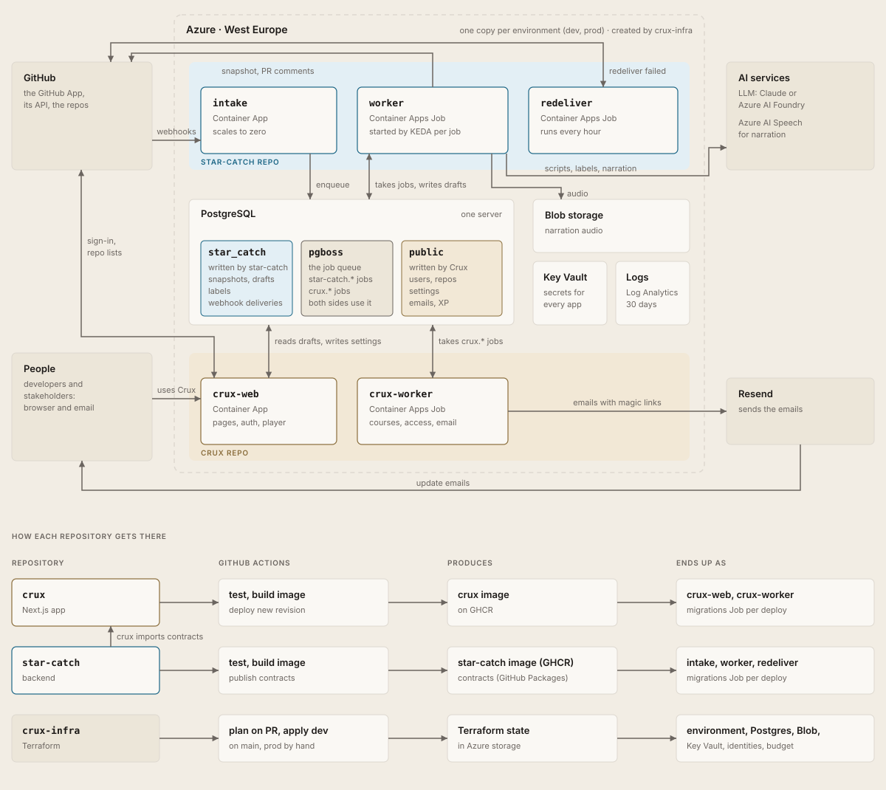

# Star Catch — project plan (02830 Advanced Project in Digital Media Engineering)

Solo. Hand-in **02/12/2026** (noon), defence **18/12/2026**.
Rewritten from scratch on 21/09/2026 against the accurate feature description and workflow.
Revised every Wednesday.
Step-by-step checklist across all repositories: [ROADMAP.md](ROADMAP.md).

---

## 1. What changed since the first plan

| Then | Now |
|---|---|
| A new repository, pnpm + Turborepo skeleton, Azure + Terraform | **Star Catch is a feature inside Crux.** It lands in `apps/web/src/modules/starCatch/`. Crux already runs on Firebase App Hosting + Firestore; Azure supplies OpenAI and Speech only |
| One update per pull request | **Two cuts per pull request** — technical and business — from one shared context |
| A bespoke slides-plus-audio player | **Remotion**: an interactive player now, MP4 export later |
| Generate, then publish | **Draft → published**, tied to the merge. Generated on open, regenerated only on request, never silently after approval |
| Design still to be done | **Both pages are designed** (list + detail artifacts). Those tasks are implementation-only |

Deleting the infrastructure block freed roughly six days. Two cuts, narration sync and the
draft/published lifecycle spent them again — the total is close to where it was.

### Revised 01/10/2026

| Was (21/09) | Now |
|---|---|
| Star Catch is a feature inside Crux (`apps/web/src/modules/starCatch/`) | **The backend is this repository** ([docs/backend.md](docs/backend.md)): webhook intake, PR snapshots, change analysis, context, scripts, scenes, narration, PR comments, publishing. Crux keeps the pages, auth, settings, chat, XP and email |
| Crux on Firebase App Hosting + Firestore; Azure for OpenAI and Speech only | **Everything on Azure** (Crux's `docs/azure-migration.md`): Container Apps, Postgres + pg-boss, Blob, Key Vault, all provisioned by `crux-infra` |
| PR context from one LLM call over the whole PR | **Context by classification** ([docs/pr-analysis.md](docs/pr-analysis.md)): change units from a tree-sitter diff in 16–222 ms per PR ([docs/changes.md](docs/changes.md)), labels from rules and a fast model |
| Generation job on Cloud Tasks + Cloud Run | A pg-boss queue drained by a Container Apps Job |

The graded path runs offline from this repository's CLI; the live path is Tier B
([docs/backend.md](docs/backend.md) §9).

## 2. Goal

> Prototype the Star Catch update — a narrated, scene-synced video with an equivalent article,
> generated from a merged pull request — and measure whether someone who cannot read code
> understands the change **more accurately** and **faster** from that update than from the pull
> request itself.

**The object of study is the business cut**, because the participants are non-engineers. The
technical cut is product, not evidence.

**Outside the goal:** deciding *which* changes deserve an update; private-repo
permission modelling; production reliability; MP4 export; migrating any other Crux feature.

**How it is tested:** within-subject, classmates as participants, pull requests from one public OSS
repo. Baseline = the pull request as it exists on GitHub. Treatment = the generated update.
Measured: **comprehension accuracy** against a frozen question bank, and **time to understand**.
**Correctness of the generated update is scored separately** against reference descriptions written
from the authors' own words — a fluent-but-wrong update must be visible in the results.

## 3. Budget

- 10 ECTS ≈ 275 h. Three weeks gone → **≈ 210 h ≈ 26 working days** to 02/12.
- **Tier A below is ≈ 31.5 days.** That is ~5.5 days over, and it is over *on purpose* rather than
  by accident: §7 says what comes out first, so the decision is made now and not in week ten.
- Paper is **2 pages**, ACM two-column, solo.

## 4. Course dates

| Week | Date | Due from me |
|---|---|---|
| 4 | **23/09** | **Premortem + risk assessment** — 3 slides, 5 min + 5 min Q&A |
| 5 | 30/09 | Peer session |
| 6 | 07/10 | Test-methods lecture — protocol drafted by then |
| 7 | 21/10 | Peer testing |
| 8 | 28/10 | Scientific-writing lecture — paper skeleton |
| 9 | 04/11 | **Study run 1** |
| 10 | 11/11 | **Study run 2** |
| 11 | 18/11 | **Study run 3** |
| 12 | 25/11 | **Final presentation** |
| 13 | **02/12** | **Hand-in**: paper + appendices + code zip |
| — | 18/12 | **Defence** |

## 5. Architecture

Three repositories, one Azure environment per stage (dev, prod):

| Repository | What it holds | Runs as |
|---|---|---|
| `crux` | Next.js app: pages (list, detail, settings), auth, Remotion player, chat, quiz/XP, emails; its own worker for courses, repo-access events and Star Catch emails | Container App `crux-web` + Container Apps Job `crux-worker` |
| `star-catch` (this one) | Backend: `apps/intake` (GitHub webhook), `apps/worker` (snapshot → analysis → generation → comments → publish), `apps/cli` (offline runs for the study), `packages/contracts` (types Crux imports), `packages/changes`, `packages/pipeline`, `packages/adapters` | Container App `star-catch-intake` + Container Apps Jobs `star-catch-worker`, `star-catch-redeliver` |
| `crux-infra` | Terraform for everything above: Container Apps environment, Postgres, Blob, Key Vault, identities, budget | GitHub Actions (OIDC) |

Shared at runtime: one Postgres server (schemas `public` for Crux, `star_catch` for the backend,
`pgboss` for the queue), one storage account (narration audio), one Key Vault. The two codebases
talk only through queue jobs and read-only views; every table has one writer.

**The seam that matters** is the classifier: one change unit in, labels out
([docs/changes.md](docs/changes.md) §6). A fast hosted model fills it today; Jev, trained on the
stored labels, takes over later without anything else changing.

External services: GitHub (App, API, webhooks, GHCR for images), Claude or Azure AI Foundry for the
LLM and the fast classifier, Azure AI Speech for narration, Resend for email. Every one sits behind a
port with a mock twin (`STAR_CATCH_MOCK` in the backend, `CRUX_MOCK_*` in Crux), so the whole
pipeline runs offline — which is what makes it demoable on a laptop and testable without paying per
video.

---

## 6. The board

Three columns: **To Do / Doing / Done**. `G/R` = gain (does the grade depend on it) / risk (do I
know how to do it). High gain first even when risky; among low-gain tasks, cheapest first.

### Tier A — the graded path (≈ 31.5 days)

#### Phase 0 — Frame and de-risk (now → 30/09)

| ID | Task | Days | G/R | Done when |
|---|---|---|---|---|
| SC-01 | Premortem: rehearse the three slides, cut to 5:00, risk register current | 0.5 | H/L | Presented 23/09. `docs/premortem.md` is already drafted — this is rehearsal, not writing |
| SC-02 | Goal, non-goals, two personas, three scenarios → numbered requirements | 1 | H/L | `docs/requirements.md`; every task below traces to a requirement number |
| SC-03 | PR corpus: pick the public OSS repo, 10–12 merged PRs across a deliberate spread of difficulty, cached as fixtures, **each with a reference description written from the authors' own words** | 1.5 | H/L | Pipeline runs fully offline; every PR has ground truth to score generated output against |
| SC-04 | **Tracer bullet**: one fixture PR → Claude → two structured cuts → narrated scenes playing on a bare page | 2 | H/H | End to end, ugly, real, on one command. **This is the essential-and-hard task — it goes first** |

#### Phase 1 — Generation (weeks 5–7)

| ID | Task | Days | G/R | Done when |
|---|---|---|---|---|
| SC-05 | Domain types + ports in `packages/contracts`: `StarCatchDetail`, `Cut`, `Scene`, `Classifier`, `Narrator` | 1 | M/L | Types compile; the classifier or the narrator can be swapped without touching anything else |
| SC-06 | PR context builder: Claude, structured output, schema-validated, fixture-driven, **scored against the SC-03 references** | 2 | H/H | All fixtures yield valid context; a wrong claim shows up as a low correctness score, not as prose nobody checked |
| SC-07 | Two-cut script generation — technical and business — from the one stored context | 1.5 | H/M | Same PR yields two genuinely different scripts; the business one contains no identifier a non-engineer would have to look up |
| SC-08 | Scene breakdown: script → `Scene[]` (title, callout, code, closing) with a duration budget | 1.5 | H/M | Scenes are data; business cut ≈ 90 s, technical ≈ 3–4 min |
| SC-09 | Narration: Azure Speech adapter, SSML, **word-boundary marks** → audio + timeline JSON | 2 | H/H | Audio plus a word→millisecond timeline. Fallback if marks misbehave: one audio clip per sentence |
| SC-10 | Mock adapters for the whole pipeline behind `CRUX_MOCK_*` | 1 | M/L | `CRUX_MOCK=true` produces a full catch with no network |

#### Phase 2 — The thing people watch (weeks 6–8)

| ID | Task | Days | G/R | Done when |
|---|---|---|---|---|
| SC-11 | Remotion: `UpdateComposition` + scene components in Crux tokens (cream/petrol/ink, Plex, JetBrains Mono) | 2 | H/M | A `Scene[]` renders as a video that looks like Crux, not like a template |
| SC-12 | Detail page: header, player, article accordion, role toggle (design done — implementation only) | 2 | H/M | A non-engineer opens a link and can watch and read without being told how |
| SC-13 | Narration playback synced to scenes | 1.5 | H/H | Words land with the scene they belong to across all fixtures |
| SC-14 | Article view from the same structured data | 1 | M/L | Same update readable in under two minutes with no audio |

#### Phase 3 — The study (weeks 8–11)

| ID | Task | Days | G/R | Done when |
|---|---|---|---|---|
| SC-15 | Experiment design: within-subject protocol, counterbalancing, frozen question bank, consent form, **two separate scores** (comprehension, correctness) | 2 | H/H | Reviewed against the 07/10 lecture; nothing changes after data collection starts |
| SC-16 | Instrumentation: session timing, answer capture, CSV export | 1 | H/L | One clean row per participant per condition |
| SC-17 | Pilot with 2 peers in **week 6–7** | 1 | H/M | Answers the one question that cannot wait: is the task too easy to show any difference? |
| SC-18 | Study runs 04/11, 11/11, 18/11 (target n ≈ 12) | 2 | H/M | Data collected, consent filed, protocol unchanged mid-study |
| SC-19 | Analysis: accuracy and time per condition, plots, effect size, limitations | 1.5 | H/L | Paper-ready figures; the conclusion is stated even if negative |

#### Phase 4 — Communicate (weeks 10–13)

| ID | Task | Days | G/R | Done when |
|---|---|---|---|---|
| SC-20 | Related work + method justification (SmartNote, CHID, release-note generation, comprehension-study methods) | 1 | M/L | Half a page, every claim checked against the paper itself |
| SC-21 | Final presentation (25/11) | 1 | H/L | Delivered; the demo runs live |
| SC-22 | Paper draft, ACM two-column, 2 pages | 2 | H/M | Every required section present, under the limit |
| SC-23 | Hand-in (02/12): revision, appendices, contribution overview, code zip | 1 | H/L | Submitted before noon |
| SC-24 | Defence prep (18/12) | 0.5 | H/L | Can answer "what was the most essential and hard problem" in two sentences |

### Tier B — product completeness (≈ 18 days, grade-neutral)

This is what turns a study instrument into Star Catch. None of it earns a mark; all of it is
needed for Crux pilots, and it is the natural December–January work.

| ID | Task | Days |
|---|---|---|
| SC-25 | Postgres schemas + repositories: `star_catch` (catches, versions, runs) in this repo; subscribers, reactions, events in Crux | 1.5 |
| SC-26 | Star Catch list page — repo sections, rails, first-run repo selection (design done) | 2 |
| SC-27 | `intake`: owns the GitHub App webhook, signature verification, dedupe, enqueue; Crux's access events forwarded through the queue | 1.5 |
| SC-28 | Generation worker: pg-boss + Container Apps Job, run lifecycle, supersede rule | 2 |
| SC-29 | Post the two PR comments, each linking into Crux | 1 |
| SC-30 | `@star-catch update/fix` handling (`issue_comment`) → regeneration | 1.5 |
| SC-31 | Merge → publish: resolve recipients (PR participants + repo defaults + per-catch additions) | 1.5 |
| SC-32 | Email fan-out + magic link, Crux account created lazily | 2 |
| SC-33 | Subscribers panel on the draft | 1 |
| SC-34 | Chat: fix mode (draft) and ask mode (published), both grounded in the stored context | 1.5 |
| SC-35 | End states: quiz + XP for the technical cut, emoji reaction for the business cut | 1.5 |
| SC-36 | Author approval surface: review, edit, publish | 1.5 |

### Tier C — after 02/12

| ID | Task |
|---|---|
| SC-38 | MP4 export — Remotion renderer on a Container Apps Job (in Crux) |
| SC-39 | Multi-repo weekly digest |
| SC-40 | Private-repo policy: what leaves the boundary, stated and enforced |
| SC-41 | Slack delivery alongside email |

---

## 7. Cut order, decided in advance

Tier A is 5.5 days over. Cut from the top, and record which one and why — that record is a
paragraph in the paper's process section.

1. **SC-13 narration sync** → per-sentence audio chunks instead of word timings (−1)
2. **SC-09 narration entirely** → silent video plus article, stated as a limitation (−2)
3. **SC-08 scene variety** → three scene kinds, not five (−0.5)
4. **SC-12 role toggle** → ship the business cut only; participants are non-engineers anyway (−0.5)
5. **SC-03 corpus** → 8 pull requests instead of 12 (−0.5)
6. **SC-10 mocks** → fixtures on disk, no adapter switching (−1)
7. Study n from 12 to 8 — **last resort**, it weakens the only evidence there is

Never cut: SC-03's reference descriptions, SC-04, SC-06, SC-15, SC-18, SC-19, SC-22, SC-23.

## 8. Weekly ritual (Wednesdays)

1. Move cards. Anything in Doing more than three days gets split or dropped.
2. Answer out loud: *what is the most essential and hard problem right now, and am I on it?*
3. Re-estimate remaining Tier A against weeks left; if over, apply §7 and write down what went.

## 9. Open decisions

| Question | Needed by |
|---|---|
| Which public OSS repo is the corpus from? Needs frequent, varied, self-contained PRs | SC-03, this week |
| Does the baseline show raw GitHub, or a stripped-down PR view? GitHub's UI is a confound, but it is what people face | SC-15, before 07/10 |
| Final presentation date — the playbook says 25/11, lecture 3's slides say 18 Dec | Ask on Wednesday |
| Whether the technical cut is evaluated at all, or declared product-only in the paper | SC-15 |
