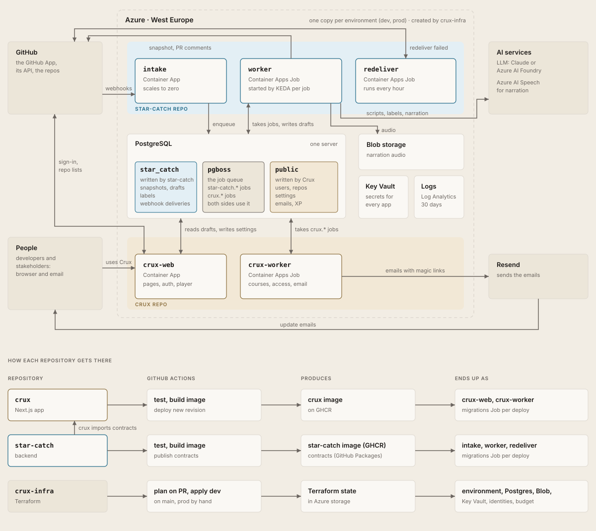
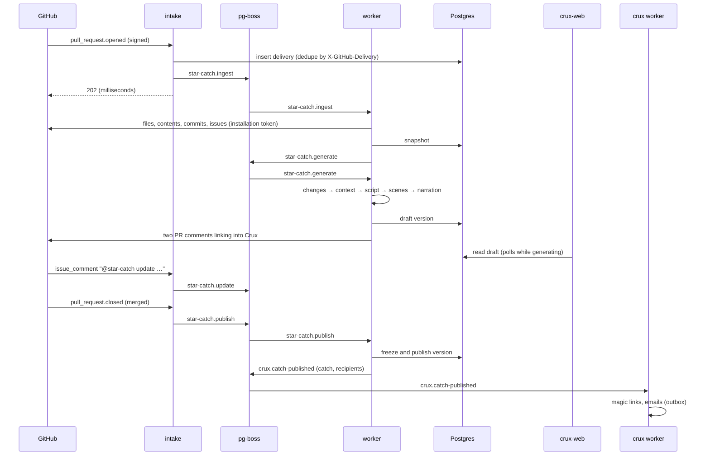

# Star Catch backend — a repository of its own

Everything Star Catch does without a signed-in user moves out of Crux into this repository
(`kiasm-tech/star-catch`): receiving the GitHub App's webhooks, snapshotting pull requests,
analysing them, building the context, writing the scripts and scenes, narrating, posting the PR
comments, handling `@star-catch update`, and publishing on merge. Crux keeps the pages, auth,
email and everything a user does on them, and reads the backend's results from the shared
database.

§9 says how to sequence it so the offline path never waits for the live parts.

Related: [changes.md](changes.md) (the change-analysis package) ·
[pr-analysis.md](pr-analysis.md) · Crux's `docs/azure-migration.md` (Postgres, pg-boss, Container
Apps — this design sits on its Phases 1 and 4).

---

## 1. The split

**Rule:** triggered by GitHub or by time → backend. Triggered by a signed-in user, or needs a
Crux identity (sessions, magic links, XP) → Crux.

| Concern | Lives in | Notes |
|---|---|---|
| GitHub App webhook (all events) | backend · `intake` | The app has one webhook URL; `intake` owns it and routes Crux's events to Crux through the queue |
| PR snapshot | backend · `worker` | Today's Crux code (`ingest.ts`, `fetchPullRequestSnapshot.ts`, `pullRequestSnapshot.ts`) |
| Change analysis | backend · `packages/changes` | [changes.md](changes.md) |
| Context, classification, sections, script, scenes, article data | backend · `packages/pipeline` | No I/O: the CLI, the worker and the tests run the same code |
| Narration audio | backend · `worker` → Blob | Playback stays in Crux |
| PR comments, `@star-catch update` | backend · `worker` | Comments are edited in place on regeneration |
| Publish on merge, recipients | backend · `worker` | Hands the emails to Crux |
| Repo enablement, stakeholders, subscribers | Crux (settings UI) | The backend reads them |
| List page, detail page, player (Remotion), article view | Crux | Reads catches through views, typed by `contracts` |
| Chat (ask and fix), quiz, XP, reactions, views | Crux | Fix-mode edits go to the backend as jobs |
| Email + magic links | Crux · worker | Better Auth mints the links |
| Installation/member/team/org/repo events (repo access) | Crux · worker | Existing `githubWebhook.ts` handlers, now fed by the queue |
| MP4 export | Crux | Later; the composition is Crux's |

## 2. System



Lifecycle of one pull request:



## 3. Repository layout

```
star-catch/
  apps/
    cli/               # driving adapter + composition root: record fixtures, analyse, build a catch offline
    intake/            # Hono HTTP server: POST /github/webhook, GET /healthz
    worker/            # pg-boss consumers + the redeliver entrypoint
  packages/
    contracts/         # PUBLISHED: zod schemas Crux imports (see §5)
    changes/           # domain: change units (changes.md), pure
    pipeline/          # application core: use cases and the ports they need; no I/O
    adapters/          # driven adapters implementing those ports — each with a mock twin
    testkit/           # test-only: builders, the context matcher, fixture loaders
  test/                # repo-wide tests, including the architecture rules
  db/migrations/       # the star_catch schema
  fixtures/            # recorded PRs + webhooks, synthetic PRs (moved from Crux)
  docs/                # design docs
  README.md
  Dockerfile           # one image, entrypoints: intake | worker | redeliver
```

- pnpm workspace, TypeScript strict, vitest, zod, Node 22 (Crux's base image).
- `changes` is a workspace package, not a separate repo: the worker is its only consumer, so
  nothing needs publishing.
- Hexagonal: dependencies point inward (`apps → adapters → pipeline → changes → contracts`). The
  core owns its ports; adapters implement them; each app's `compose.ts` is the only place that picks
  adapters. `test/architecture.test.ts` and ESLint enforce it.
- `pipeline` has no I/O: every external call (LLM, speech, GitHub, storage) comes through a port,
  so the CLI, the worker and the tests run the same code.
- Adapters live in `packages/adapters/src/<area>/` as `<port>.real.ts` plus a deterministic
  `<port>.mock.ts` that works offline. `compose.ts` reads `STAR_CATCH_MOCK`, overridden per service
  by `STAR_CATCH_MOCK_<SERVICE>`.
- zod schemas are the source of truth and types are inferred from them; anything Crux reads lives
  in `contracts`. Adapters hand raw data to the core, which parses it.
- Every GitHub call has a timeout; nothing runs after `intake` answers.
- Tests: vitest, colocated `*.test.ts`, no network. A new package gets a line in
  `test/architecture.test.ts`.

## 4. Services

### 4.1 `intake` (Container App, scale to zero)

```
POST /github/webhook
  1. Read the raw body; verify X-Hub-Signature-256 (HMAC-SHA256, constant time) → 401 if bad.
  2. Insert (delivery_id, event, action, installation_id, received_at, payload) into
     star_catch.webhook_deliveries; on conflict (redelivery) → 202, nothing else.
  3. Route:
       pull_request (opened, reopened, ready_for_review, synchronize, closed) → star-catch.ingest / .stale / .publish
       issue_comment (created, body mentions @star-catch)                      → star-catch.update
       installation*, member, team, membership, organization, repository       → crux.github-event
       anything else                                                           → stored, not routed
  4. 202.
```

- No GitHub calls, no LLM, no filtering that needs other tables: one insert and one enqueue, so it
  answers in milliseconds. GitHub waits 10 s for a reply and **does not retry failed deliveries on
  its own**; a small Node image starting from zero stays well inside that, a cold Next.js app may
  not.
- Filters that need data (draft PRs, bot authors, repos without Star Catch, the spend cap) run in
  the worker's first step, so a misconfigured filter never loses a delivery.
- Payloads for Crux's events are passed through unchanged; the signature was checked here.

### 4.2 `worker` (Container Apps Job, started by a KEDA `postgresql` rule)

| Queue | Does | Retries |
|---|---|---|
| `star-catch.ingest` | Filter (enabled repo, not draft, not bot, under spend cap) → snapshot with an installation token → save → enqueue `star-catch.generate` | 5, exponential backoff |
| `star-catch.generate` | `analyze()` (changes) → context → two scripts → scenes → article → narration → draft version → PR comments | 3; each step saved in `catch_runs` so a retry resumes |
| `star-catch.stale` | `synchronize`: mark the draft stale (no regeneration) | 3 |
| `star-catch.update` | `@star-catch update <instruction>`: check the commenter has write access, regenerate | 3 |
| `star-catch.revise` | From Crux's chat (fix mode) or the author's edits: patch scenes or regenerate | 3 |
| `star-catch.publish` | `closed` + merged: freeze the current version, resolve recipients, enqueue `crux.catch-published` | 5 |

- pg-boss replaces today's ingest-job table, the 8 s inline budget and `/api/star-catch/sweep`:
  retries, backoff and dead-lettering are built in, and `singletonKey` (repo + head SHA) dedupes.
- One job per execution; the KEDA rule counts `created` and `retry` jobs whose name starts with
  `star-catch.`. Set the rule's polling interval to ~5 s (the Container Apps default is 30 s) so a
  draft starts within seconds of the webhook.

### 4.3 `redeliver` (scheduled job, hourly)

Lists the app's recent deliveries (`GET /app/hook/deliveries`, app JWT), finds failed ones not in
`webhook_deliveries`, and asks GitHub to redeliver them
(`POST /app/hook/deliveries/{id}/attempts`). This covers `intake` being down or slow — today a
missed delivery is simply lost.

## 5. Contracts with Crux

`packages/contracts`, published to GitHub Packages as `@kiasm-tech/star-catch-contracts`. Crux
pins a version; a breaking change bumps the major and ships with a migration.

| Contract | Contents |
|---|---|
| Domain | `Catch`, `CatchVersion`, `Cut`, `Scene` (from Crux's `starCatch/types.ts`), `NarrationClip`, `Article`, the context schema and label sets (`context/schema.ts`, `context/labels.ts`) |
| Snapshot | `PullRequestSnapshotSchema` (moves from Crux's `pullRequestSnapshot.ts`) |
| Jobs | Queue names and payload schemas, both directions: `star-catch.revise`, `crux.github-event`, `crux.catch-published` |
| Read views | Row schemas of the views Crux reads (§6) |
| Queue | The pg-boss major version both sides must run (they share one `pgboss` schema) |

Crux keeps what only the UI uses: the Remotion composition, scene components, `buildTimeline()`,
hooks and pages.

## 6. Data

One Postgres server (the Azure plan's B1ms), two owners. **Every table has exactly one writer.**

| Schema / table | Writer | Read by | Purpose |
|---|---|---|---|
| `star_catch.webhook_deliveries` | intake | redeliver | Dedupe, audit, recovery |
| `star_catch.pr_snapshots` | worker | worker, Crux (view) | Immutable PR snapshots keyed by repo + head SHA |
| `star_catch.catches` | worker | Crux (view) | One per PR: status draft/published, current version, stale |
| `star_catch.catch_versions` | worker | Crux (view) | Cut, scenes, narration clips, article, context |
| `star_catch.catch_runs` | worker | Crux (view) | Step, status, error, tokens — progress for the UI |
| `star_catch.catch_pr_comments` | worker | worker | Comment ids to edit on regeneration |
| `star_catch.unit_labels` | worker | worker | Classifier cache and Jev training data ([changes.md](changes.md) §6) |
| `public.star_catch_repos`, `public.stakeholders`, `public.catch_subscribers` | Crux | backend (view) | Settings and recipients |
| `public.repo_contexts` | Crux | backend (view) | Repo context reused for the PR context |
| `public.catch_deliveries`, `catch_views`, `catch_reactions`, `catch_questions`, `catch_chat`, `xp_events` | Crux | Crux | Delivery outbox and engagement |
| `pgboss.*` | both, via pg-boss | both | The queue |

- The backend migrates `star_catch` (its own `db/migrations`); Crux migrates `public`.
- Cross-reads go through views (`star_catch.v_catches`, `public.v_star_catch_settings`, …) with a
  read-only role per service, so a table can change without breaking the other side as long as the
  view holds. Row schemas live in `contracts`.
- Writes across the boundary are jobs, never `INSERT`s into the other schema.

## 7. Secrets and identities

| Secret | intake | worker | crux-web | crux worker |
|---|---|---|---|---|
| GitHub webhook secret | ✓ | | | |
| GitHub App id + private key | | ✓ | ✓ (repo access, courses) | ✓ |
| GitHub App client id/secret (sign-in) | | | ✓ | |
| Database URL (own role) | ✓ | ✓ | ✓ | ✓ |
| LLM keys, Speech key | | ✓ | ✓ (courses, chat) | |
| Storage account | | ✓ | ✓ | |

All from Key Vault through managed identities, as in the Azure plan. The webhook secret leaves
Crux entirely.

## 8. Local development and tests

- `docker compose up`: Postgres, `intake`, `worker` with mock adapters.
- `pnpm replay fixtures/webhooks/<pr>.opened.json`: signs and posts a recorded webhook to the local
  `intake`; the worker produces a draft from the recorded snapshot. No network.
- `pnpm catch fixtures/synthetic/09-ts-extract` (CLI): snapshot → catch JSON on stdout, with the
  LLM and speech mocked or real (`STAR_CATCH_MOCK=false`).
- Tests: everything Crux has today for ingest, snapshots, context and fixtures moves with the code;
  plus an end-to-end test (replay → intake → queue → worker → draft row) on a Postgres
  testcontainer, and contract tests that Crux's views and job payloads parse with `contracts`.

## 9. Sequencing

The offline path needs none of the live parts: the CLI runs the pipeline on recorded and synthetic
PRs. So:

1. **Offline first:** `contracts`, `packages/changes`, `packages/pipeline` and `apps/cli`. Crux's
   detail page renders a catch from `contracts` types loaded from fixture JSON.
2. **After Azure Phases 1 and 4 (Postgres, pg-boss):** `intake`, `worker`, PR ingest moved out of
   Crux, the GitHub App's webhook URL switched, Crux consuming the queue.
3. **Then:** PR comments, regeneration and publishing in the worker; engagement in Crux.

## 10. Moving the code out of Crux

| Crux path | Goes to | Then in Crux |
|---|---|---|
| `src/modules/starCatch/server/ingest.ts`, `lib/ingestJob.ts` | `apps/worker` (as pg-boss handlers) | deleted |
| `src/modules/github/server/fetchPullRequestSnapshot.ts`, `github.real.ts#getPullRequestSnapshot` | `packages/adapters/github` | deleted |
| `src/modules/github/server/pullRequestSnapshot.ts` | `contracts` | imported from `contracts` |
| `src/modules/starCatch/server/context/**` | `contracts` (schema, labels) + `testkit` (fixtures loader, matcher) | deleted |
| `src/modules/starCatch/fixtures/**` | `fixtures/` | UI fixtures only |
| `pull_request` / `issue_comment` cases in `githubWebhook.ts` | `intake` routing | deleted |
| `app/api/github/webhooks/route.ts` | — | deleted after the URL switch; the access handlers run from `crux.github-event` |
| `app/api/star-catch/sweep/route.ts`, datastore Star Catch methods | — | deleted |
| `src/modules/starCatch/types.ts` (domain types) | `contracts` | imported from `contracts` |

The switch-over (step 2 of §9): deploy `intake` + `worker`, make Crux's worker consume
`crux.github-event`, point the GitHub App's webhook URL at `intake`, watch a few deliveries, delete
Crux's webhook route.

## 11. Open points

- **Fix-mode chat latency:** a `star-catch.revise` job waits for the KEDA poll and a job start
  (seconds, not instant). Fine for regeneration; if small edits should feel instant, `intake` can
  grow an internal `POST /catches/:id/revise` that patches inline.
- **pg-boss version** is shared across two repos; upgrades happen in both at once.
- **Repo name:** `kiasm-tech/star-catch` for the existing local repository (no remote yet).
