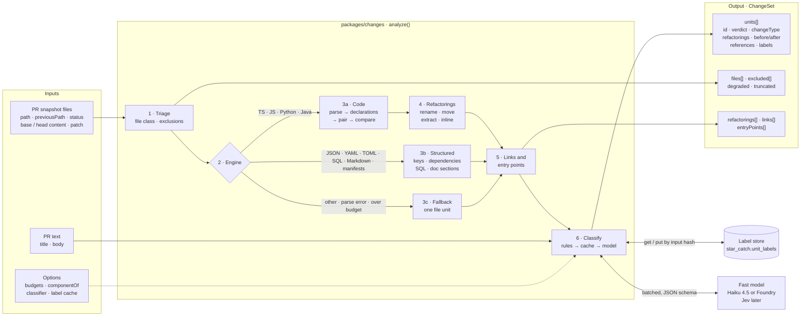
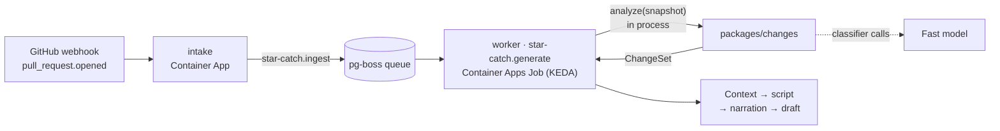

# Change units — `packages/changes`

A TypeScript package of the Star Catch backend ([backend.md](backend.md)) that turns a pull request snapshot into
**change units**: the smallest named things that changed, each with a verdict, a change type, the
refactorings that explain it and — optionally — labels from a fast classifier. It implements the
code lane of [pr-analysis.md](pr-analysis.md) (steps 2–8). The worker's `star-catch.generate` job calls it and
`packages/pipeline` maps the result onto the context (schema in `packages/contracts`).

Package: `@star-catch/changes`, a workspace package used by the worker and the CLI; not published.

---

## 1. Speed

Measured in a spike on the recorded zustand PRs (Apple Silicon laptop, warm, Node 20,
`web-tree-sitter@0.27.0`): parse base and head, extract declarations with a query, pair them by
name, compare token hashes.

| PR | Size | Time |
|---|---|---|
| zustand#3443 | 1 file, 27k chars | 16 ms |
| zustand#3555 | 2 files, 85k chars | 72 ms |
| zustand#3469 | 2 files, 205k chars | 222 ms |
| Start-up | WASM runtime + 2 grammars | 24 ms |

The spike left out the per-unit change type and refactoring detection; both only look at units that
changed. Azure's amd64 cores will be slower than the laptop (expect ~1.5–2×).

Why it's fast and simple:

- **Declarations, not a full tree diff.** Pairing declarations by name and comparing their token
  streams is linear; a token diff runs only inside the few declarations that changed.
- **Refactorings from hashes.** Rename, move, extract and inline are found with token hashes over the
  added, removed and changed declarations — the only places a refactoring can show.
- **In process.** It runs inside the worker that already runs the job: no cold start, no network
  hop, nothing extra to deploy.
- **Upstream grammars and queries.** tree-sitter grammars ship WASM builds and a `tags.scm` query
  that names definitions and references; field names (`name`, `body`, `condition`) give headers and
  conditions without a per-language node table.

## 2. Inputs and outputs



Where it runs (the full system is in [backend.md](backend.md) §2):



## 3. What a change is

### 3.1 The unit

| Where | Unit | `unitKind` | Name |
|---|---|---|---|
| Code | A declaration: function, method, class, interface, type alias, enum, top-level constant or variable, class field | `declaration` | Qualified by containers: `Cart.total`; Go methods by receiver: `Cart.Total` |
| Test code | A test case: `describe` / `it` / `test` with a literal title (JS/TS); test functions and methods are already declarations (Python, Java) | `declaration` | Title path: `persist > rehydrates on mount` |
| Code outside any declaration | Imports, top-level statements | `file` | File basename |
| JSON, YAML, TOML | A key path, top level and one level down | `configKey` | `server.port` |
| Manifests | A dependency | `dependency` | `dependencies.zod` |
| SQL | A statement; tables and columns name it | `schemaEntity` | `orders.gift_note` |
| Markdown, MDX | A heading section | `docSection` | `Install > macOS` |
| Unsupported, unparseable, over budget | The whole file | `file` | File basename |

- **Identity:** `id = ${path}#${name}` (head path; base path for removed files). A renamed or moved
  unit takes its head name. Duplicate names in one file get ` (2)`, ` (3)`.
- **Test cases are units** (new compared with synthetic fixture 08, where the test file was one
  unit): "added 8 test cases to persist" is what the Quality facts need, and a 178k-char test file
  with one new `it(...)` must not be one opaque unit.

### 3.2 Tokens

- **Tokens** are the leaves of the syntax tree in order. Whitespace is never a token.
- **Comments** are dropped: node types containing `comment`, plus Python docstrings (a string
  expression statement that opens a module, class or function body).
- **Own tokens** of a declaration skip the subtrees of declarations nested in it — each of those is
  its own unit. A class whose only change is a new method has unchanged own tokens.
- **Hash** = sha1 of the own tokens joined with `\0`.

### 3.3 Verdict

| Verdict | Rule |
|---|---|
| `notAChange` | Base and head own tokens are equal but the text differs (formatting, comments). Recorded, not classified. |
| `structural` | Own tokens differ and every difference is explained by a detected refactoring (§3.5). |
| `behavioural` | Anything else, including added and removed units not explained by a move, extract or inline. An unexplained edit is always behavioural. |

### 3.4 Change type

First match wins:

1. `added` / `removed`: the unit exists on one side only.
2. `moved`: paired across files or containers (§3.5).
3. For a changed unit, a **token diff** (Myers) of base vs head own tokens; each differing token is
   located in the head tree (deleted tokens in the base tree):
   - `signatureChanged`: before the declaration's `body` field (name, parameters, return type,
     modifiers, decorators). For variables and fields: the name and type annotation; the value is
     the body.
   - `conditionChanged`: inside a `condition` field (if, while, for, ternary in TS/JS/Java/Go), a
     switch/case value, Python's `a if cond else b` middle child, or a comparison/boolean expression
     (`binary_expression` whose `operator` is `< > <= >= == != === !== && ||`, Python
     `comparison_operator` / `boolean_operator` / `not_operator`).
   - `bodyChanged`: everything else.

### 3.5 Refactorings

Candidates are the **unpaired** declarations: removed by name (`R`, base side) and added by name
(`A`, head side), across all files of the same language family in the PR. Each rule must hold
exactly; anything unproven stays behavioural.

| Refactoring | Rule | Result |
|---|---|---|
| **Rename** | `r ∈ R`, `a ∈ A`, same file (following file renames) and container, own tokens equal once `r.name → a.name` | One unit (head name), `signatureChanged`, structural `[rename]`; adds `r.name → a.name` to the substitution map |
| **Move** | `r ∈ R`, `a ∈ A`, different file or container, own tokens equal (after a rename, if names differ) | One unit at the head location, `moved`, structural `[move]` (+ `rename`); adds a qualifier rule for the name |
| **Callers and imports** | A changed unit whose base tokens, after the substitution map and after dropping qualifiers added or removed before moved names (`X.`, `X::`, `this.`, `self.`, import specifiers and paths), equal its head tokens | Structural with the types used |
| **Extract** | `e ∈ A` and a paired changed unit `S`, with `Rs`/`As` the statements removed from/added to `S`'s body (statements hashed by own tokens): (1) every statement of `e`'s body except a trailing `return x` is in `Rs`; (2) every statement in `As` calls `e`; (3) every other statement in `Rs` equals some `As` statement once the call to `e` is replaced by `e`'s returned expression | `S` structural `[extract]` (`bodyChanged`); `e` structural `[extract]` (`added`) |
| **Inline** | The mirror image: `i ∈ R`, every `Rs` statement calls `i`, `i`'s body statements are in `As`, leftovers map back by replacing the returned expression with the call | `S` and `i` structural `[inline]` |
| **Local rename** | A changed unit whose token diff is a consistent one-to-one substitution of identifiers and nothing else (variables, parameters) | Structural `[rename]` |

Checked against the synthetic fixtures: 03 and 10 (rename + callers), 09 (TS extract: the
leftover `lines.push(\`Total: ${subtotal + tax}\`)` maps to the head line once `orderTotal(order)`
is replaced by `subtotal + tax`), 12 (Python extract through `self._subtotal()`), 13 (Java extract +
move to another class with the caller's new `Money.` qualifier).

Not detected in v1 (behavioural): extract/inline variable, extract class or interface, pull up /
push down, parameter reordering, refactorings spanning languages.

## 4. Languages

| Tier | Languages | What works |
|---|---|---|
| **1 · v1** | **TypeScript + TSX, JavaScript + JSX, Python, Java** | Declarations, test cases, change types, refactorings, links, entry points |
| 2 · next | Go | Same as tier 1; grammar and `tags.scm` already checked |
| 3 · on demand | C#, Kotlin, Rust, Ruby, PHP | Same, one language at a time |
| Structured · v1 | JSON / JSONC, YAML, TOML, SQL, Markdown / MDX; manifests `package.json`, `pyproject.toml`, `requirements*.txt`, `pom.xml`, `build.gradle(.kts)`, `go.mod`, `Cargo.toml` | Keys, dependencies, statements, sections |
| Fallback | Everything else | One `file` unit per file, `degraded`, still classified from its patch |

Why these: Crux and its first users are TypeScript/Next.js; the synthetic fixtures already cover
TS, Python and Java; and they are among the most used languages on GitHub. Go is the next most
likely in the target market.

Grammars checked in the spike (all load in `web-tree-sitter@0.27.0` and ship a `.wasm` and
`queries/tags.scm`): `tree-sitter-typescript@0.23.2` (typescript + tsx), `tree-sitter-javascript@0.25.0`,
`tree-sitter-python@0.25.0`, `tree-sitter-java@0.23.5`, `tree-sitter-go@0.25.0`.

Adding a language (≈ ½–1 day): vendor its WASM, write `definitions.scm` and `language.ts` (§5.3),
add fixtures for formatting, comment, rename, condition and extract.

## 5. Pipeline

### 5.1 Triage

Every file gets a class. Lockfiles, generated, vendored and binary files leave here as `excluded`
(context `excluded`). The rest choose an engine.

| Class | Rule (path or content) |
|---|---|
| `lockfile` → excluded | `pnpm-lock.yaml`, `package-lock.json`, `yarn.lock`, `bun.lock(b)`, `poetry.lock`, `uv.lock`, `Pipfile.lock`, `Cargo.lock`, `go.sum`, `Gemfile.lock`, `composer.lock` |
| `generated` → excluded | `@generated` / `DO NOT EDIT` in the first 5 lines; `*.min.js`, `*.pb.go`, `*_pb2.py`, `__generated__/`, `*.generated.*`, `dist/`, `build/` |
| `vendored` → excluded | `vendor/`, `third_party/`, `node_modules/` |
| `binary` → excluded | No content for its status, or a NUL byte in the first 8 KB |
| `test` | `*.test.*`, `*.spec.*`, `__tests__/`, `tests/`, `test_*.py`, `*_test.py`, `*_test.go`, `src/test/` |
| `schema` | `migrations/`, `migration/`, `migrate/`, `*.sql`, `schema.prisma` |
| `config` | JSON/YAML/TOML outside the above; `.env.example` |
| `manifest` | the manifests listed in §4 |
| `docs` | `*.md`, `*.mdx`, `docs/` |
| `buildCi` | `.github/workflows/`, `Dockerfile*`, `docker-compose*`, `Makefile`, `.gitlab-ci.yml` |
| `source` | everything else |

The class feeds the rule labels (§6.1) and the context's file triage (pr-analysis step 2).

### 5.2 Parse

- One `Parser` per language, created lazily and reused; grammars load once per process from
  vendored bytes (`Language.load(Uint8Array)`).
- **Budget:** `parser.parse(text, null, { progressCallback })` returns `true` from the callback past
  the per-file budget (default 500 ms) → that file falls back to lines.
- **Errors:** tree-sitter always recovers. An `ERROR` or missing node only matters where it
  overlaps a changed declaration: that unit becomes behavioural `bodyChanged` and its file is
  marked `degraded`. Errors elsewhere are ignored (new syntax the grammar doesn't know must not
  sink the whole file).
- Call `tree.delete()` when done: trees live in the WASM heap.
- Offsets: verify in M1 that `startIndex` is a UTF-16 index (JS string index) with a non-ASCII
  fixture; `before`/`after` slice the source with it.

### 5.3 Declarations

Per language, `src/languages/<lang>/definitions.scm` (a tree-sitter query, started from upstream
`tags.scm`) captures `@definition.callable | type | variable | test` and `@name`.
`src/languages/<lang>/language.ts` holds what a query can't express.

TypeScript/TSX (JavaScript uses the same file minus the type-only lines):

```scheme
(function_declaration name: (identifier) @name) @definition.callable
(generator_function_declaration name: (identifier) @name) @definition.callable
(function_signature name: (identifier) @name) @definition.callable
(method_definition name: (property_identifier) @name) @definition.callable
(method_signature name: (property_identifier) @name) @definition.callable
(abstract_method_signature name: (property_identifier) @name) @definition.callable
(class_declaration name: (type_identifier) @name) @definition.type
(abstract_class_declaration name: (type_identifier) @name) @definition.type
(interface_declaration name: (type_identifier) @name) @definition.type
(type_alias_declaration name: (type_identifier) @name) @definition.type
(enum_declaration name: (identifier) @name) @definition.type
(public_field_definition name: (property_identifier) @name) @definition.variable
(program (lexical_declaration (variable_declarator name: (identifier) @name)) @definition.variable)
(program (export_statement (lexical_declaration (variable_declarator name: (identifier) @name)) @definition.variable))
(expression_statement
  (call_expression
    function: [(identifier) (member_expression)] @fn
    arguments: (arguments . [(string) (template_string)] @name))
  (#match? @fn "^(describe|it|test|context)(\\.(only|skip|each|concurrent))?$")) @definition.test
```

Python:

```scheme
(function_definition name: (identifier) @name) @definition.callable
(class_definition name: (identifier) @name) @definition.type
(module (expression_statement (assignment left: (identifier) @name)) @definition.variable)
(class_definition body: (block (expression_statement (assignment left: (identifier) @name)) @definition.variable))
```

Java:

```scheme
(class_declaration name: (identifier) @name) @definition.type
(interface_declaration name: (identifier) @name) @definition.type
(enum_declaration name: (identifier) @name) @definition.type
(record_declaration name: (identifier) @name) @definition.type
(annotation_type_declaration name: (identifier) @name) @definition.type
(method_declaration name: (identifier) @name) @definition.callable
(constructor_declaration name: (identifier) @name) @definition.callable
(field_declaration declarator: (variable_declarator name: (identifier) @name)) @definition.variable
```

`language.ts` per language:

```ts
export const typescript: LanguageSpec = {
  id: "typescript",
  grammar: "tree-sitter-typescript.wasm",          // tsx: "tree-sitter-tsx.wasm"
  extensions: [".ts", ".mts", ".cts"],
  /** Nodes that wrap a declaration and belong to its span. */
  wrappers: ["export_statement", "decorator"],
  isComment: (n) => n.type === "comment",
  /** Conditions beyond `condition` fields. */
  conditionNodes: { switch_case: "value" },
  booleanOperators: ["<", ">", "<=", ">=", "==", "!=", "===", "!==", "&&", "||", "!"],
  /** Name text of a test title: strip quotes. */
  testName: (title) => title.slice(1, -1),
};
```

Python adds `isDocstring`, `decorated_definition` as a wrapper and the `conditional_expression`
middle child; Java adds `block_comment` / `line_comment` and annotations (they're children of
`modifiers`, already in the header).

Each declaration becomes `{ name, qualifiedName, category, node, outer, bodyStart, hash }`. The
qualified name joins the names of enclosing type and callable declarations (`Cart.total`,
`outer.inner`). Hashes are only computed for declarations that overlap a changed line range from the
patch (or a line diff when the patch is missing) — unchanged declarations are skipped, which keeps
very large files cheap.

### 5.4 Pair and compare

1. Pair base and head declarations by qualified name (file renames: base path → head path).
2. Equal hashes and equal text → no unit. Equal hashes, different text → `notAChange`.
3. Different hashes → token diff → change type (§3.4), verdict behavioural for now.
4. Unpaired → `R` / `A` for §3.5; what remains is `removed` / `added`.
5. Tokens outside every declaration form the file's residue → a `file` unit if it changed
   (`notAChange` when only formatting/comments did).
6. Each unit records `before` / `after` (its own text, ≤ 2000 chars each), `span` (base and head
   line ranges) and `references` (identifiers its head version calls or uses, via the `@reference.*`
   captures of `tags.scm` plus identifiers in its body, capped at 100).

### 5.5 Refactorings

The rules of §3.5, in this order: rename and move pairing over `R × A` (exact hash buckets first;
no fuzzy matching in v1), then callers and imports with the substitution map, then extract and
inline against changed units, then local renames. Every refactoring is reported once in
`refactorings[]` with its type, a one-line description (`orderTotal extracted from receiptLines`)
and the units it explains.

### 5.6 Structured files

Rules:

| Format | Parser | Units |
|---|---|---|
| JSON / JSONC | `jsonc-parser` | key paths, top level and one down |
| YAML | `yaml` (multi-document: `[0].`, `[1].` prefixes) | same |
| TOML | `smol-toml` | same |
| Manifests | the above + `fast-xml-parser` (pom), line rules (Gradle, `go.mod`, `requirements.txt`) | one `dependency` per package; the rest of the file as one `file` unit |
| SQL | own splitter (quotes, comments, dollar-quoting) | one per statement; `CREATE/ALTER/DROP TABLE` → table or `table.column`; everything in a migrations folder is a `schemaEntity` |
| Markdown / MDX | own line scanner (ATX + setext, skips fences) | one per heading path; text before the first heading is `(intro)` |

Values equal after normalising whitespace and formatting → `notAChange`.

### 5.7 Fallback

One behavioural `file` unit, `changeType` from the status (`renamed` → `moved`), `degraded: true`,
`error` says why. `before`/`after` carry the first 2000 chars of the patch, so the classifier still
sees the change.

### 5.8 Links and entry points

- `calls`: a unit's `references` contain another changed unit's name.
- `covers`: a test unit references a changed unit's name, or its file imports the unit's file.
- `sharesData`: later (needs data-entity resolution).
- Entry points, by rules:

| Framework | Rule | Type |
|---|---|---|
| Next.js | default export of `app/**/page.(tsx\|jsx)`, `pages/**` (not `pages/api`) | `page` |
| Next.js | exported `GET/POST/PUT/PATCH/DELETE` in `app/**/route.(ts\|js)`; `pages/api/**` | `apiRoute` |
| Express / Fastify / Hono | handler passed to `app\|router.(get\|post\|put\|patch\|delete)("/…", …)` | `apiRoute` |
| FastAPI / Flask | decorated by `@app\|router.(get\|post\|…)` or `@app.route` | `apiRoute` |
| Spring | annotated `@GetMapping`, `@PostMapping`, `@RequestMapping`, … | `apiRoute` |
| Spring / Celery / cron | `@Scheduled`, `@shared_task`, `@app.task` | `job` |
| CLI | Python `if __name__ == "__main__"`, `@click.command`; `bin` entries of `package.json` | `command` |
| Library | exported declarations of the files named by `package.json` `main`/`exports` | `exportedApi` (v2) |

## 6. Classification

A **change** for classification is one unit with verdict `behavioural`. Structural units get rule
labels only (they feed the technical cut's structure change, never the business cut). `notAChange`
units are not classified. One unit is one item: the model sees a single unit's bounded input, never
the whole PR, so a small classifier (Jev) can take over later without changing anything else.

### 6.1 Rules first (`source: rule`, confidence 1)

| Axis | Rule |
|---|---|
| `kind` | `test` (test file or test unit) · `configuration` (config key or config file) · `data` (schema entity, migration) · `dependency` · `documentation` · `buildCi` · `ui` (TSX/JSX declaration whose body returns JSX) · otherwise the model picks `logic`, `interface`, `data` or `ui` |
| `intent` | structural units → `refactor`; otherwise the model |
| `visibility` | the model (hints passed in: exported? entry point type?) |
| `risks` | `dataMigration` (schema entity in a migration) · `untested` (behavioural `logic` unit with no `covers` link from a test unit in the PR) · `gated` (references a changed key of a flags/feature config) · `breaking` and `securitySensitive` from the model |

### 6.2 Cache

`inputHash = sha256(labelSetVersion, classifier.id, normalised unit input)`. Before calling a
model, look the hashes up in the label cache; after, store the results. The cache is a port; the worker
implements it on Postgres — the same rows are the training data for Jev (model labels = silver,
human corrections in the draft editor = gold, as pr-analysis.md §4 plans).

```sql
create table unit_labels (
  input_hash   text primary key,
  classifier   text not null,           -- "model:haiku-4-5@prompt-1"; kept here, not in the context
  input        jsonb not null,          -- the exact unit input, for training
  labels       jsonb not null,          -- { kind, intent, visibility, risks, confidence }
  source       text not null,           -- rule | model | human
  created_at   timestamptz not null default now()
);
```

### 6.3 Fast model now, Jev later

- **Now:** a small hosted model behind the `Classifier` port — `claude-haiku-4-5` (already used by
  Crux for cheap calls) or the Azure AI Foundry deployment through the backend's OpenAI-compatible
  adapter. The package owns the prompt, the JSON schema and batching; the worker passes a
  `complete()` function built on its LLM adapter, so keys and provider selection stay out of the
  package.
- **Prompt:** system message = the label definitions (each label with one line and one example) and
  "pick, never describe"; user message = a JSON array with every behavioural unit and sentence of
  the PR — one call per PR, as [pr-analysis.md](pr-analysis.md) §4 says, split only past ~60k
  characters of input; output forced through a tool/JSON schema that returns one result per id.
  Temperature 0.
- **Item input** (bounded, ≈ 1–2k tokens): path, language, file class, unit kind, change type,
  name, a unified token diff of the unit (or `before`/`after` ≤ 2000 chars each), sibling
  declaration names, `references`, the PR title, the rule labels already decided.
- **Output per item:** `kind` (if not decided by rules), `intent`, `visibility`,
  `breaking: boolean`, `securitySensitive: boolean`, and a confidence 0–1 per axis. Self-reported
  confidence is not calibrated; treat it as a hint until Jev provides calibrated probabilities.
- **Throughput:** split calls run in parallel (4 at a time), under a classification budget (default
  20 s). Units still unlabelled when it runs out are returned without model labels; the pipeline proceeds
  (labels are optional in the context).
- **Jev:** trained on `unit_labels` once there are enough rows. It goes behind the same port —
  run in process (e.g. ONNX Runtime in the worker) or behind the optional HTTP image. Routing: Jev
  first; the model only for axes where Jev's confidence is below a threshold. It replaces the model
  only if it matches the gold labels at least as well.

Expected latency: the analysis itself stays in milliseconds; classification is one model round
trip for a typical PR. Measure in M3.

## 7. API and contract

```ts
export function analyze(input: AnalyzeInput, options?: AnalyzeOptions): Promise<ChangeSet>;

export type AnalyzeInput = {
  files: {
    path: string;
    previousPath?: string;
    status: "added" | "removed" | "modified" | "renamed";
    base?: string;             // absent for added files
    head?: string;             // absent for removed files
    patch?: string;            // GitHub's hunks; narrows hashing (§5.3) and feeds the fallback
  }[];
  pr?: { title: string; body?: string | null };   // classifier context only
};

export type AnalyzeOptions = {
  componentOf?: (path: string) => string;         // the repo's component map; default: top-level folder
  classifier?: Classifier;                        // omit → rule labels only
  labelCache?: LabelCache;                        // omit → no cache
  budgets?: { perFileMs?: number; analysisMs?: number; classifyMs?: number }; // 500 / 5 000 / 20 000
  signal?: AbortSignal;
};

export type ChangeSet = {
  analyzerVersion: string;
  labelSetVersion: 1;
  degraded: boolean;            // some file fell back to lines or had parse errors in a changed unit
  truncated: boolean;           // a budget or cap cut the analysis short
  files: { path: string; language: string; fileClass: FileClass; engine: "code" | "structured" | "lines"; degraded: boolean; error?: string }[];
  units: Unit[];                // ChangeUnit of schema.ts (component filled) + the fields below
  refactorings: { type: "rename" | "move" | "extract" | "inline"; description: string; unitIds: string[] }[];
  links: { from: string; to: string; type: "calls" | "sharesData" | "covers" }[];
  entryPoints: { unitId: string; type: "page" | "apiRoute" | "command" | "job" | "exportedApi" }[];
  excluded: { file: string; reason: "lockfile" | "generated" | "vendored" | "binary" }[];
  timings: { totalMs: number; analysisMs: number; classifyMs: number };
};

export type Unit = ChangeUnit & {
  fileClass: FileClass;
  span: { base?: [number, number]; head?: [number, number] };  // 1-based line ranges
  references: string[];
};

export interface Classifier {
  id: string;                                               // stored with labels, not in the context
  classify(items: ClassifyItem[], signal?: AbortSignal): Promise<ClassifyResult[]>;
}
export function createModelClassifier(options: {
  id: string;
  complete: (request: { system: string; user: string; schema: object }) => Promise<unknown>;
  maxInputChars?: number; // 60 000: below it, one call per PR
  concurrency?: number;   // 4, for split calls
}): Classifier;

export interface LabelCache {
  get(inputHashes: string[]): Promise<Map<string, StoredLabels>>;
  put(entries: StoredLabels[]): Promise<void>;
}
```

zod schemas are the source of truth (`src/schema.ts`); label sets come from `packages/contracts`,
the same copy Crux reads (`LABEL_SET_VERSION` must match).

`packages/pipeline` maps a `ChangeSet` onto the context: `units` → `context.units` (dropping `fileClass`, `span`,
`references` or keeping them in a side table), `links`, `entryPoints`, `excluded` → as is,
`degraded` / `truncated` → as is.

## 8. Package layout

```
packages/changes/
  src/
    index.ts                 # analyze(), public types
    schema.ts                # zod: input, ChangeSet, Unit, classifier I/O
    triage.ts                # file classes and exclusions
    budget.ts                # deadlines, AbortSignal plumbing
    languages/
      registry.ts            # extension → language, lazy grammar loading
      typescript/ definitions.scm  language.ts
      javascript/ …  python/ …  java/ …
    code/
      parse.ts               # web-tree-sitter wrapper, progressCallback budget
      declarations.ts        # query → declarations, qualified names, spans
      tokens.ts              # own tokens, hashes, comments, docstrings
      diff.ts                # Myers over tokens, located changes
      compare.ts             # pairing, verdict, change type
      refactorings.ts        # §3.5
    structured/              # json, yaml, toml, manifests, sql, markdown
    fallback.ts
    links.ts                 # calls, covers, entry points
    classify/
      rules.ts  model.ts  prompt.ts  cache.ts
  grammars/                  # vendored .wasm + upstream tags.scm, manifest.json (versions, sha256)
  scripts/vendor-grammars.ts # copies grammars from devDependencies, writes the manifest
  server/                    # optional HTTP wrapper: main.ts (Hono)
  test/
    *.test.ts                # over the repo's fixtures/ (13 synthetic PRs + expected.json, recorded PRs)
  bench/run.ts               # timings over the recorded fixtures
```

Tooling: TypeScript (strict), pnpm, vitest, zod, Node 22 (Crux's base image is `node:22-alpine`).
Runtime dependencies: `web-tree-sitter`, `zod`, `jsonc-parser`, `yaml`, `smol-toml`,
`fast-xml-parser`, a small Myers diff. Grammar packages are **dev** dependencies only: their `install`
script (`node-gyp-build`) builds a native Node binding, which nothing here needs; `vendor-grammars` copies just the
`.wasm` and `.scm` files into `grammars/`, which ships in the package.

Bundling: if the worker is bundled (esbuild), copy `grammars/` and `web-tree-sitter.wasm` next to
the bundle. The package resolves its WASM files with `new URL("../grammars/…", import.meta.url)` and
passes `locateFile` to `Parser.init`.

## 9. Running it

**In the worker (primary).** No cold start of its own: WASM runtime + grammars load in ~25 ms,
once per job process.

```ts
import { analyze, createModelClassifier } from "@star-catch/changes";

const changes = await analyze(
  { files: snapshot.files.map(toInput), pr: { title: snapshot.title, body: snapshot.body } },
  {
    componentOf: repoComponents(snapshot),
    classifier: createModelClassifier({ id: "model:haiku-4-5@prompt-1", complete: llm.completeJson }),
    labelCache: db.unitLabels(),
    signal: job.signal,
  },
);
```

**HTTP wrapper (optional, only if a non-Node caller appears).** `server/` would wrap `analyze()` in
`POST /v1/analyze` with a secret header and 8 MB / 300 file limits. Local testing goes through the
repo's CLI (`apps/cli`).
`node:22-alpine`, multi-arch (WASM is portable — no amd64 pin). As a Container App with scale to
zero, a cold start is container start plus Node boot (a few seconds at most, mostly image pull);
set `minReplicas: 1` only if something latency-sensitive ever calls it.

Local checks:

```sh
pnpm test                       # fixtures, contract, determinism
pnpm bench                      # timings over test/fixtures/recorded
pnpm dev:server                 # POST /v1/analyze on :8080
pnpm eval:classify              # runs the classifier on the labelled fixtures, prints agreement (needs a key)
```

## 10. Budgets and limits

| Limit | Default | When exceeded |
|---|---|---|
| Files | 300 (snapshot cap) | rejected by the HTTP server; the library takes the first 300 and sets `truncated` |
| Parse per file | 500 ms | that file → lines |
| Token diff per unit | 20 000 tokens a side | change type `bodyChanged` without locating tokens |
| Rename/move candidates | 5 000 pairs | exact hash buckets only (already the v1 rule) |
| Analysis total | 5 s | remaining files → lines, `truncated` |
| Classification | 20 s, 4 batches in flight | remaining units unlabelled |

Deterministic: same input and versions → same output (stable sorting everywhere, no reliance on
`Map` order across runs). Never logs file contents; one log line per call with counts and timings.

## 11. Testing

- **Fixtures as the answer key:** the 13 synthetic fixtures with their `expected.json`, matched
  with `expectContextMatches` (both move from Crux to `fixtures/` and `pipeline`). Update fixture 09 to
  structural `[extract]` and fixture 08 to test-case units (§3.1).
- **Per stage:** triage rules, declaration queries per language (one sample file each), token rules
  (comments, docstrings, nested declarations), change types (signature, condition per construct,
  body), each refactoring rule with a positive and a near-miss negative case.
- **Contract:** a golden `request.json` → `response.json` covering every engine.
- **Recorded PRs:** the three zustand snapshots must finish without fallback; `bench` prints timings.
- **Performance gate in CI:** each recorded PR under 1 s (5× the spike's worst case, to absorb CI
  noise).
- **Determinism:** analyse every fixture twice, compare.
- **Non-ASCII:** a fixture with `é` and emoji, checking `before`/`after` slices.
- **Classifier:** rules unit-tested; the model classifier tested with a fake `complete()`; real
  model only in `eval:classify`, outside CI.

## 12. Milestones

| # | Scope | Done when |
|---|---|---|
| M0 | Package, vendored grammars, `parse` + `declarations` for the 4 tier-1 languages | Every sample file yields the expected declarations; zustand files parse in < 300 ms |
| M1 | Tokens, pairing, verdicts, change types, file residue, structured engine, fallback, triage | Fixtures 01, 02, 04–08, 11 pass; recorded PRs run without fallback |
| M2 | Refactorings (§3.5) | Fixtures 03, 09, 10, 12, 13 pass with their refactorings |
| M3 | Classification: rules, cache port, model classifier, `eval:classify` | Labels on all synthetic fixtures; eval report; latency measured |
| M4 | Links and entry points | Fixture 08: `covers` link and `page` entry point |
| M5 | Worker integration | `star-catch.generate` builds a context from a replayed webhook; labels land in `unit_labels` |
| M6 | Go | Go fixtures pass |

## 13. Risks and open points

- **Refactoring detection** covers the shapes in §3.5 only; an extract that also renames variables,
  or a partial extract, stays behavioural. Accepted: a miss is always "behavioural", the safe side.
  Measure on the fixtures plus a hand-labelled set of real PRs before relying on it.
- **Grammar freshness:** `tree-sitter-typescript` was last published in Nov 2024. New syntax yields
  `ERROR` nodes; §5.2 limits the damage to the affected unit. If needed, build the WASM from the
  grammar repo with the tree-sitter CLI.
- **ABI:** the runtime and grammar WASMs must stay compatible — pin versions, check in M0 (the spike
  loaded all five grammars in `web-tree-sitter@0.27.0`).
- **Classifier confidence** from a hosted model is uncalibrated until Jev.
- **Test-case units** change synthetic fixture 08; confirm before M1.
