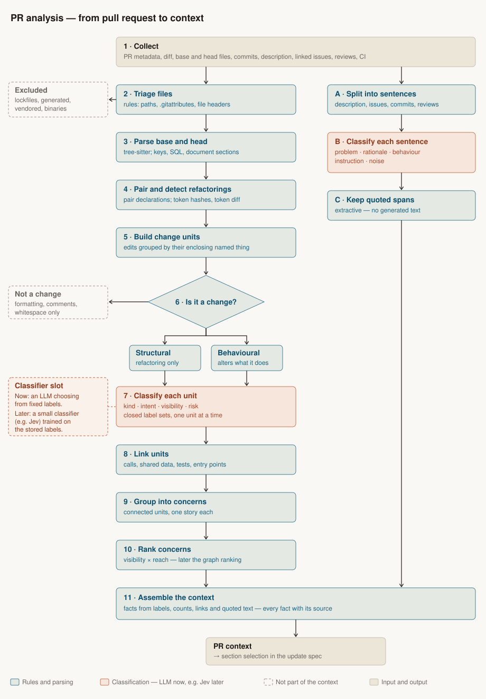

# PR analysis — from pull request to context

The first half of Star Catch: turn a pull request into a **context**, a structured account of what
changed, built entirely from classification. The update spec
([spec-update-structure.md](spec-update-structure.md)) reads only this context.

## Design goals

1. **Classification only.** Every judgement is a choice from a closed set of labels over a bounded
   input. The context holds labels, counts, links and quoted text — never generated prose. An LLM can
   make those choices today; a small classifier (e.g. Jev) can make them later without anything else
   changing.
2. **Deterministic where possible.** Parsing, diffing, refactoring detection, linking and grouping
   are rules and algorithms. The model decides only what rules can't.
3. **Conservative about "no change".** Something is dropped only when it is positively identified as
   noise or as a known refactoring. An edit nobody can explain counts as a behavioural change.
4. **Traceable.** Every fact points to the units or sentences it came from.
5. **Reproducible.** The input is a snapshot keyed by the head commit. Same snapshot, same label-set
   version, same context.

---

## 1. What counts as a change

### The unit

A **change unit** is the smallest named thing that changed.

| Where | Unit |
|---|---|
| Code | A declaration: function, method, class, type or top-level constant |
| Configuration (JSON, YAML, TOML, env examples) | A key |
| Schema or migration | An entity, table or column |
| Dependency manifest | A dependency |
| Documentation | A section |
| Anything else | The whole file |

### The verdict

| Verdict | When | Where it goes |
|---|---|---|
| **Not a change** | Only whitespace, formatting or comments differ; or the file is a lockfile, generated, vendored or binary | Recorded, left out of the context |
| **Structural** | The unit differs only by a detected refactoring — rename, move, extract, inline — so behaviour is preserved | Into the context, tagged structural. Feeds the technical cut's *Structure change*; never the business cut |
| **Behavioural** | Anything else | Into the context |

An edit that is not recognised as noise or as a refactoring is **behavioural by default**. Failing to
detect a refactoring is not evidence that behaviour changed — but it is not evidence that it didn't,
either, so the safe side is to keep it.

---

## 2. The algorithm

Two lanes start from the same snapshot and meet in the context.

### Code lane

| Step | What happens | Draws on |
|---|---|---|
| **1 · Collect** | Snapshot the PR at its head commit: metadata, diff, full base and head content of changed files, commits, description, linked issues, review comments, CI. Immutable, keyed by head SHA | GitHub API |
| **2 · Triage files** | Rules give each file a class: source, test, configuration, schema/migration, documentation, build & CI, dependency manifest, lockfile, generated, vendored, binary. The last four leave here. A dependency *manifest* stays — adding a dependency is a change; lockfile churn isn't | `.gitattributes` (`linguist-generated`, `linguist-vendored`), `@generated` headers, known paths |
| **3 · Parse base and head** | Code through tree-sitter (TypeScript, JavaScript, Python and Java first); structured files by key, statement or section. A file that won't parse, or takes too long, falls back to a line diff, whole file as one unit | tree-sitter |
| **4 · Pair and detect refactorings** | Declarations pair by name; a token diff runs inside the ones that changed. Renames, moves, extractions and inlines are found from token hashes over the added, removed and changed declarations | Token hashes |
| **5 · Build change units** | Each changed declaration, key, statement or section is a unit; edits outside every declaration make a file unit. Each unit gets a **change type** from where its edits sit: added, removed, signature changed, condition changed, body changed, moved | ChangeDistiller's change-type taxonomy |
| **6 · Is it a change?** | A verdict per unit, as in §1 | — |
| **7 · Classify each unit** | One unit at a time: one label per axis plus a confidence (§3) | The classifier slot (§4) |
| **8 · Link units** | Edges between units: calls or uses, same data entity, test covers, same component — matched by name from the identifiers each unit references. Framework rules mark entry points — routes, API handlers, commands, scheduled jobs, a package's exported API | Name matching, framework conventions |
| **9 · Group into concerns** | Connected parts of the link graph become **concerns**, one story each. Stray units join the concern that shares their component; tests and docs join what they cover. Most PRs have one to three | Change untangling: ClusterChanges, Flexeme, UTango; Herzig & Zeller on tangled changes |
| **10 · Rank concerns** | Importance = visibility (user > API consumer > operator > internal) × reach; ties broken by size | CHID's call-graph impact |
| **11 · Assemble the context** | Facts derived from labels, counts, links and quoted text (§5). Every fact lists its sources | — |

### Where it runs

Steps 2–8 run in the backend's worker, in process: milliseconds per pull
request, no separate service. A file that can't be parsed within its budget falls back to a line
diff and marks the context **degraded**.

| Language | Units | Refactorings |
|---|---|---|
| TypeScript, TSX, JavaScript, JSX, Python, Java | Declarations and test cases (tree-sitter) | Rename, move, extract, inline |
| Go, then others as needed | Same, once their grammar and queries are added | Same |
| JSON, YAML, TOML, SQL, Markdown, manifests | Keys, statements, sections, dependencies | — |
| Anything else | Line diff, whole file as one unit | — |

### Text lane

| Step | What happens |
|---|---|
| **A · Split into sentences** | Description, linked issues, commit messages and review comments, each sentence with an id and an origin |
| **B · Classify each sentence** | Problem · rationale · behaviour · instruction · noise. Numbers are tagged where they appear |
| **C · Keep quoted spans** | Selected sentences go into the context verbatim. Nothing is paraphrased at this stage |

---

## 3. Label sets

Closed and versioned. A label outside its set is an error, not a new category.

| Axis | Labels | Decided by |
|---|---|---|
| Verdict | not a change · structural · behavioural | Rules (steps 2–6) |
| Change type | added · removed · signature changed · condition changed · body changed · moved | Rules (step 5) |
| Component | From the repo's own map: workspace packages, CODEOWNERS, top-level modules | Rules |
| Kind | logic · interface · data · configuration · dependency · UI · test · documentation · build & CI | Rules first (file class, path); classifier when ambiguous |
| Intent | feature · fix · refactor · performance · security · maintenance | Classifier |
| Visibility | user · API consumer · operator · internal | Classifier |
| Risk *(any number)* | breaking · data migration · security-sensitive · untested · gated | Rules (migration files, flag checks, no covering test) + classifier (breaking, security-sensitive) |
| Sentence class | problem · rationale · behaviour · instruction · noise | Classifier |

Intent follows Conventional Commits; change types follow ChangeDistiller.

---

## 4. Classification only — and where Jev fits

**The classifier interface.** In: one unit — path, component, language, change type, the declaration
before and after (truncated to a fixed size), the signatures around it, its neighbours' names, the PR
title. Out: one label per axis, a confidence per label, and the name of the classifier that produced
it. Sentences use the same interface with their own label set.

**Now.** A small LLM behind the interface, chosen per environment with `STAR_CATCH_CLASSIFIER_MODEL`,
given the label definitions and asked to pick, never to describe. One call per pull request with
every unit and sentence; the model reports its own confidence per label, used only to flag labels
for review. Temperature zero; results cached by input hash and label-set version.

**Every label is stored** with its input and its source: rule, model, or human. Which model produced
a label is deliberately not recorded, so comparing two models means running both over the same
inputs.

**Humans correct labels.** When a developer's fix in the draft traces back to a wrong label, the
corrected label is stored as gold.

**Later.** A small classifier (e.g. Jev), trained on the stored labels — LLM labels as silver, human
corrections as gold — goes behind the same interface. It replaces the LLM only if it agrees with the
gold labels at least as well. Routing then becomes: small classifier first, the LLM only when
confidence falls below a threshold.

**Where generation remains.** Nowhere in the context. Text is written only after it — the narration
and the article, from the script. That is what "context through classification only" means here.

---

## 5. From labels to the facts the update spec uses

| Fact group (update spec §4) | Derived from |
|---|---|
| Identity | PR metadata (step 1) |
| Intent | Sentences classed *problem* or *rationale*, quoted |
| Shape | Components of structural and behavioural units; units added and removed |
| Interactions | Link paths that start at an entry point and cross at least two components |
| Data | Units of kind *data*, with their change type |
| Contracts | Units of kind *interface* visible to API consumers or users; the *breaking* flag |
| Rules | *Logic* units whose change type is *condition changed*, visible to users or API consumers |
| Users | *UI* units; screenshots or preview links from the PR |
| Rollout | *Configuration* units; the *gated* and *data migration* flags; sentences classed *instruction* |
| Quality | *Test* units and their *covers* links; CI status; the *untested* flag |
| Reach | Dependents of changed units (step 8), ordered by rank (step 10) |
| Evidence | Numbers that appear verbatim in the PR text or CI output — copied, never computed |

---

## 6. References

Verified in `star_catch_context.md`:
- Herzig & Zeller (2013) — the impact of tangled code changes. MSR
- Göçmen, Cezayir & Tüzün (2025) — CHID, PR-level change impact analysis. EMSE 30:64

To verify before citing in the paper:
- Fluri et al. (2007) — ChangeDistiller and its change-type taxonomy. IEEE TSE
- Barnett et al. (2015) — ClusterChanges, decomposing review changesets. ICSE
- Pârțachi et al. (2020) — Flexeme, untangling commits. ESEC/FSE
- Li et al. (2022) — UTango, graph-based untangling of commits. ESEC/FSE
- tree-sitter (parser generator) · Conventional Commits (commit-type convention)
